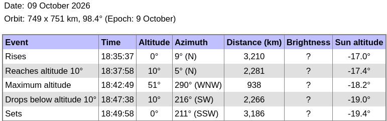

## PC acquisition with the B210

```
b210_to_file$ sudo rm /tmp/*bin* && time sudo nice -n -20 ./rx_multi_NISAR

Creating the usrp device with: num_recv_frames=1024...
[INFO] [UHD] linux; GNU C++ version 16.1.0; Boost_109000; UHD_4.9.0.1-1.4
[INFO] [B200] Detected Device: B210
[INFO] [B200] Operating over USB 3.
[INFO] [B200] Initialize CODEC control...
[INFO] [B200] Initialize Radio control...
[INFO] [B200] Performing register loopback test...
[INFO] [B200] Register loopback test passed
[INFO] [B200] Performing register loopback test...
[INFO] [B200] Register loopback test passed
[INFO] [B200] Setting master clock rate selection to 'automatic'.
[INFO] [B200] Asking for clock rate 16.000000 MHz...
[INFO] [B200] Actually got clock rate 16.000000 MHz.
Using Device: Single USRP:
  Device: B-Series Device
  Mboard 0: B210
  RX Channel: 0
    RX DSP: 0
    RX Dboard: A
    RX Subdev: FE-RX2
  RX Channel: 1
    RX DSP: 1
    RX Dboard: A
    RX Subdev: FE-RX1
  TX Channel: 0
    TX DSP: 0
    TX Dboard: A
    TX Subdev: FE-TX2
  TX Channel: 1
    TX DSP: 1
    TX Dboard: A
    TX Subdev: FE-TX1

Setting RX Rate: 22.000000 Msps...
[INFO] [B200] Asking for clock rate 22.000000 MHz...
[INFO] [B200] Actually got clock rate 22.000000 MHz.
Actual RX Rate: 22.000000 Msps...

Setting RX Freq: 1229.000000 MHz...
Setting RX LO Offset: 0.000000 MHz...
Actual RX Freq: 1229.000000 MHz...

Setting RX1 Gain: 48.000000 dB...
Actual RX0 Gain: 70.000000 dB...
Actual RX1 Gain: 48.000000 dB...

Setting antennas TX/RX...

Setting device timestamp to 0...

Begin streaming 268435440 samples, 1.500000 seconds in the future...
Done!

real    2m54.986s
user    0m0.004s
sys     0m0.014s

$ stat /tmp/*bin
  File: /tmp/1.bin
  Size: 4724871168	Blocks: 9228264    IO Block: 4096   regular file
Device: 0,40	Inode: 102         Links: 1
Access: (0644/-rw-r--r--)  Uid: (    0/    root)   Gid: (    0/    root)
Access: 2026-10-09 20:42:30.710578503 +0200
Modify: 2026-10-09 20:45:23.031590614 +0200
Change: 2026-10-09 20:45:23.031590614 +0200
 Birth: 2026-10-09 20:42:30.710578503 +0200
  File: /tmp/2.bin
  Size: 4724867072	Blocks: 9228256    IO Block: 4096   regular file
Device: 0,40	Inode: 103         Links: 1
Access: (0644/-rw-r--r--)  Uid: (    0/    root)   Gid: (    0/    root)
Access: 2026-10-09 20:42:30.710578503 +0200
Modify: 2026-10-09 20:45:23.031590614 +0200
Change: 2026-10-09 20:45:23.031590614 +0200
 Birth: 2026-10-09 20:42:30.710578503 +0200

octave> 20*22e6*2*2
ans = 1760000000
octave> 10*22e6*2*2
ans = 880000000
$ head -c 1760000000 1.bin | tail -c 880000000 > 1sur.bin
$ head -c 1760000000 2.bin | tail -c 880000000 > 2ref.bin
```

## Raspberry Pi5 / PocketSDR (MAX2771)

Maximum elevation expected at 18:42:49 UTC so acquisition software is started at 18:42:19 UTC.

```
raspberrypi:~ $ sudo ./PocketSDR/app/pocket_conf/pocket_conf pocket_NISAR_24MHz.conf
raspberrypi:~ $ sudo rm /tmp/*bin* && sudo ./PocketSDR/app/pocket_dump/pocket_dump -t 60  -r /tmp/12.bin
 TIME(s)      RAW8(B) RATE(Ks/s)
    60.0   1439694848    23992.5

octave:4> 33*24e6
ans = 792000000
octave:5> 10*24e6
ans = 240000000
```
to keep record from 23 to 33 seconds.
