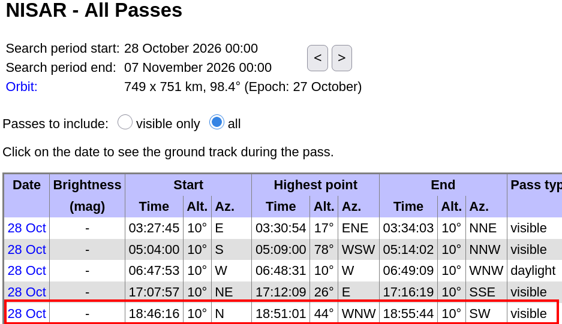
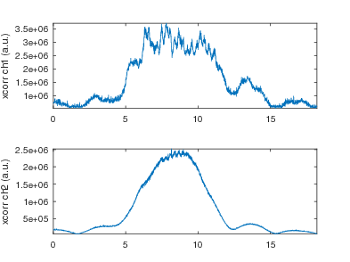
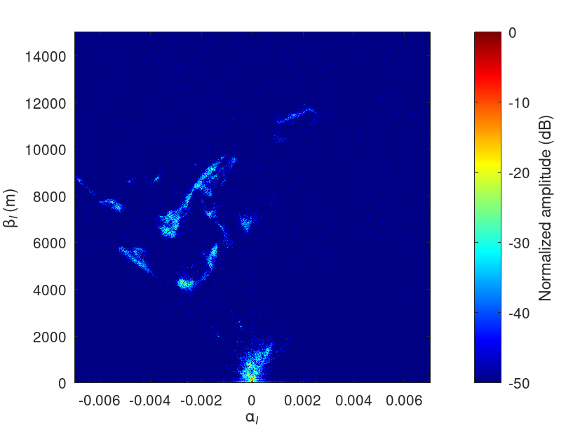
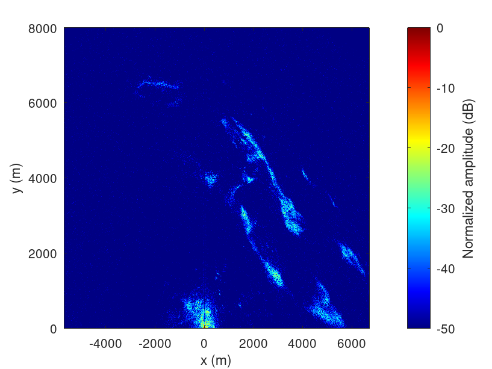
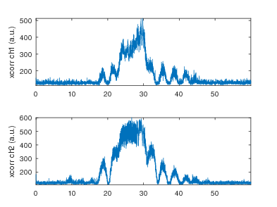
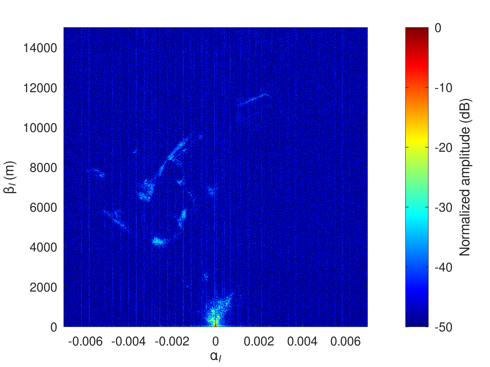
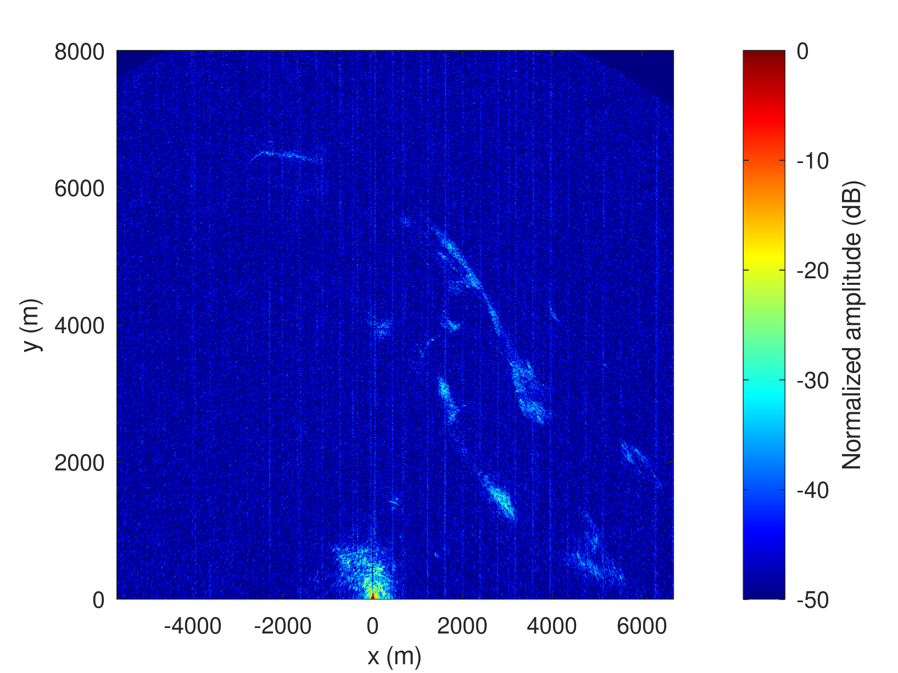

# Nov. 28 2026 NISAR pass (44 deg elevation)



## B210 acquisition on NTP synchronized PC

Full pass (cross-correlation with expected chirp shape):



```
  File: /tmp/1.bin
  Size: 1604574240	Blocks: 3133936    IO Block: 4096   regular file
Device: 0,40	Inode: 103565      Links: 1
Access: (0644/-rw-r--r--)  Uid: (    0/    root)   Gid: (    0/    root)
Access: 2026-10-28 19:50:49.138548540 +0100
Modify: 2026-10-28 19:51:09.259165662 +0100
Change: 2026-10-28 19:51:09.259165662 +0100
 Birth: 2026-10-28 19:50:49.138548540 +0100
  File: /tmp/2.bin
  Size: 1604574240	Blocks: 3133936    IO Block: 4096   regular file
Device: 0,40	Inode: 103566      Links: 1
Access: (0644/-rw-r--r--)  Uid: (    0/    root)   Gid: (    0/    root)
Access: 2026-10-28 19:50:49.138548540 +0100
Modify: 2026-10-28 19:51:09.255165539 +0100
Change: 2026-10-28 19:51:09.255165539 +0100
 Birth: 2026-10-28 19:50:49.138548540 +0100
```

Selecting the useful subset of the acquisition
```
> 12*2*2*22e6
ans = 1056000000
> 7*2*2*22e6
ans = 616000000
$ cat 1.bin | head -c 1056000000 | tail -c 616000000 > 1cut.bin
$ cat 2.bin | head -c 1056000000 | tail -c 616000000 > 2cut.bin
```

Range-azimuth compression:



Geographic coordinates:



## MAX2771 PocketSDR acquisition on Raspberry Pi5

targeted start time: 18:50:31 UTC

Full acquisition cross correlation with expected chirp:



```
$ sudo ./PocketSDR/app/pocket_conf/pocket_conf pocket_NISAR_24MHz.conf
Pocket SDR device settings are changed.
$ sudo rm /tmp/*bin* && sudo ./PocketSDR/app/pocket_dump/pocket_dump -t 60 -r /tmp/12.bin
 TIME(s)      RAW8(B) RATE(Ks/s)
    60.0   1439694848    23994.5
```

Selecting the relevant subset of the data:
```
> 34*24e6
ans = 816000000
> 14*24e6
ans = 336000000
head -c 816000000 12.bin | tail -c 336000000 > 12cut.bin
```

Benefit of file size:
```
-rw-r--r--  1 jmfriedt jmfriedt 1439694848 Oct 28 19:55 12.bin
-rw-r--r--  1 jmfriedt jmfriedt 1604574240 Oct 28 19:51 1.bin
-rw-rw-r--  1 jmfriedt jmfriedt  616000000 Oct 28 21:35 1cut.bin
-rw-rw-r--  1 jmfriedt jmfriedt  336000000 Oct 28 21:52 12cut.bin
-rw-r--r--  1 jmfriedt jmfriedt 1604574240 Oct 28 19:51 2.bin
-rw-rw-r--  1 jmfriedt jmfriedt  616000000 Oct 28 21:36 2cut.bin
```

Range-azimuth compressed image of the MAX2771 acquisition



Conversion to geographic coordinates


