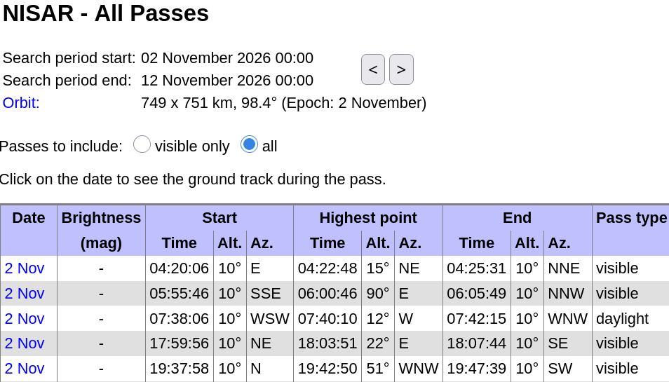
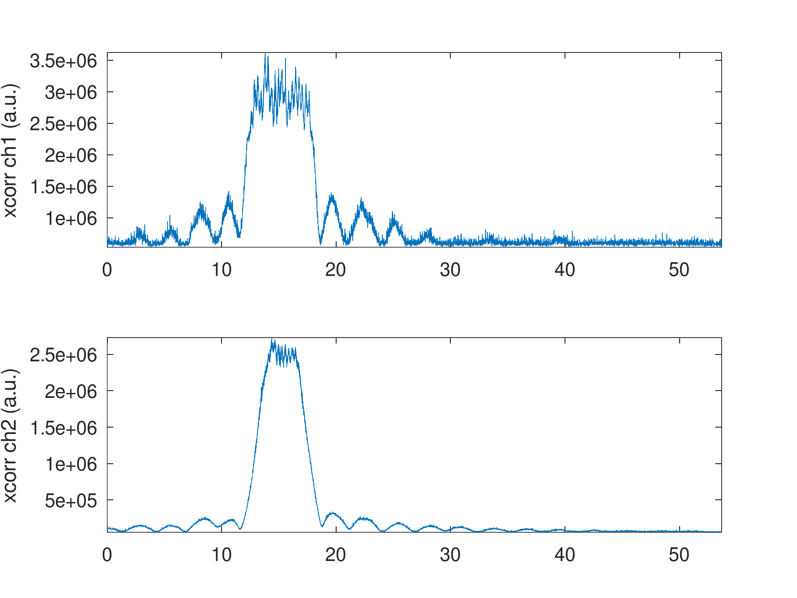
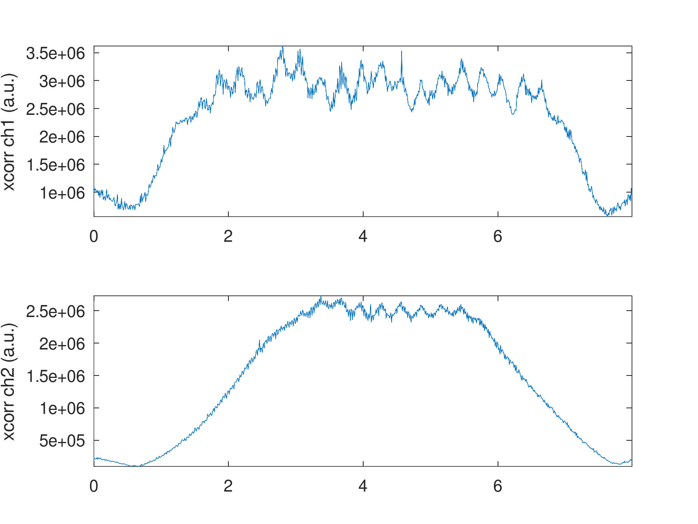
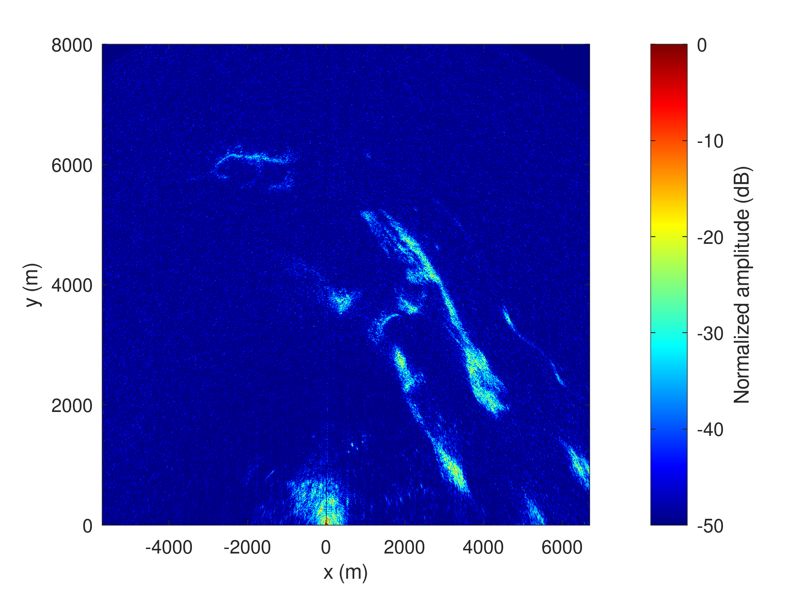
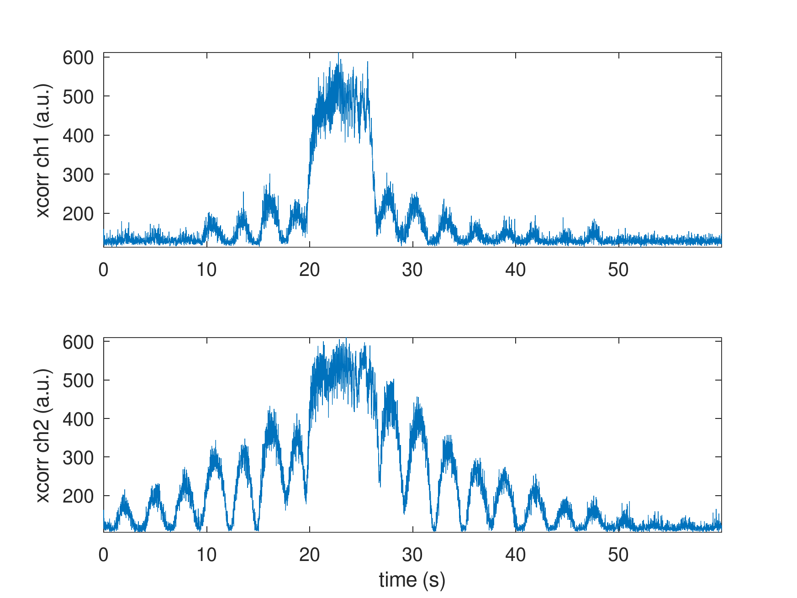

# Nov. 3rd, 2026: B210 on laptop, MAX2771 PocketSDR clone on Raspberry Pi 5



## B210

Acquisition
```
sudo nice -n -20 b210_to_file/rx_multi_NISAR
```

Time stamping the records
```
  File: /tmp/1.bin
  Size: 4724887552	Blocks: 9228296    IO Block: 4096   regular file
Device: 0,40	Inode: 84          Links: 1
Access: (0644/-rw-r--r--)  Uid: (    0/    root)   Gid: (    0/    root)
Access: 2026-11-02 19:42:31.106449821 +0100
Modify: 2026-11-02 19:43:26.292225259 +0100
Change: 2026-11-02 19:43:26.292225259 +0100
 Birth: 2026-11-02 19:42:31.106449821 +0100
  File: /tmp/2.bin
  Size: 4724875264	Blocks: 9228272    IO Block: 4096   regular file
Device: 0,40	Inode: 85          Links: 1
Access: (0644/-rw-r--r--)  Uid: (    0/    root)   Gid: (    0/    root)
Access: 2026-11-02 19:42:31.106449821 +0100
Modify: 2026-11-02 19:43:26.292225259 +0100
Change: 2026-11-02 19:43:26.292225259 +0100
 Birth: 2026-11-02 19:42:31.106449821 +0100
```



Cutting the relevant part of the dataset
```
> 19*22e6*2*2
ans = 1672000000
> 8*22e6*2*2
ans = 704000000
head -c 1672000000 /t/1.bin  | tail -c 704000000 > 1cut.bin
head -c 1672000000 /t/2.bin  | tail -c 704000000 > 2cut.bin
```





## MAX2771

On the Rasberry Pi5:
```
$ sudo ./PocketSDR/app/pocket_conf/pocket_conf pocket_NISAR_24MHz.conf
Pocket SDR device settings are changed.
$ sudo rm /tmp/*bin* && sudo ./PocketSDR/app/pocket_dump/pocket_dump -t 60  -r /tmp/12.bin
 TIME(s)      RAW8(B) RATE(Ks/s)
    60.0   1439694848    23992.1
```



Cutting the relevant part of the dataset
```
> 29.5*24e6
ans = 708000000
> 10*24e6
ans = 240000000
head -c 708000000 12.bin | tail -c 240000000 > /tmp/12cut.bin
```

