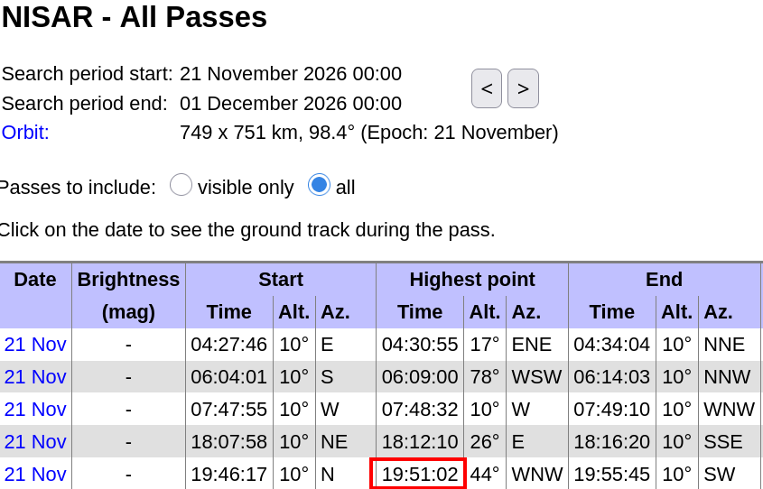
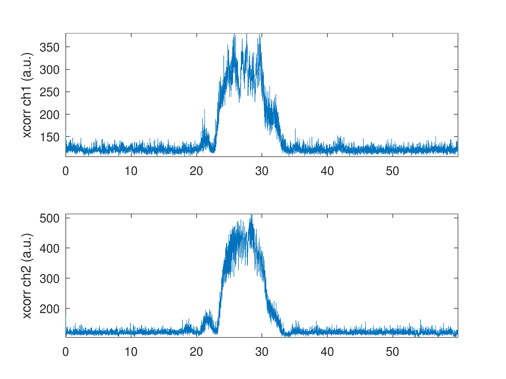
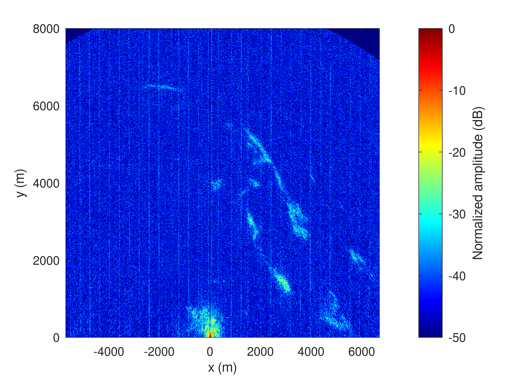

# MAX2771 acquistion (B210 failed)



```
raspberrypi:~ $ sudo ./PocketSDR/app/pocket_conf/pocket_conf pocket_NISAR_24MHz.conf
Pocket SDR device settings are changed.
raspberrypi:~ $ sudo rm /tmp/*bin* && sudo ./PocketSDR/app/pocket_dump/pocket_dump -t 60  -r /tmp/12.bin
 TIME(s)      RAW8(B) RATE(Ks/s)
    60.0   1439694848    23992.9
```

```
octave:> 34*24e6
ans = 816000000
octave:> 12*24e6
ans = 288000000
head -c 816000000 12.bin | tail -c 288000000 > 12cut.bin
```




